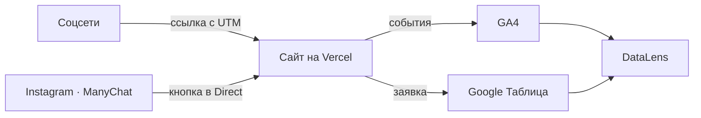

# Описание работы · ТЗ № ТЗ-05/2026 · «Портлингва»

**Исполнитель:** Михеев Николай Сергеевич, группа РПО-26/1/11 **Сайт:** https://portlingva.vercel.app

## 1. Задача заказчика

Школа иностранных языков «Портлингва» получает заявки из нескольких каналов, но не знает, какой из них приводит клиентов. Задача — сайт, на котором видно источник каждого посетителя, и одна таблица со всеми заявками.

## 2. Схема работы

Посетитель приходит из соцсетей по ссылке с UTM-метками или из Instagram через кнопку в сообщении Direct (ManyChat). Сайт отправляет события в GA4, а заявку — в Google Таблицу через Apps Script. Данные GA4 и таблицы собираются на дашборде DataLens.

Схема на Mermaid:

## 3. Сайт

Сайт из 10 страниц (главная, курсы, тест уровня из 12 вопросов, преподаватели, цены, «50 фраз» с промокодом, форма заявки, страница подтверждения, политика конфиденциальности, страница 404) написан на HTML, CSS и JavaScript. Стартовая версия создана с помощью ChatGPT и доработана вручную. Сайт опубликован на Vercel.

  

## 4. Аналитика GA4

Ресурс GA4 с Measurement ID `G-2CZ494QV10` подключён к сайту, события отправляются из `js/analytics.js`. Список событий — в [events.md](events.md).

 

## 5. UTM-ссылки и соцсети

В реестре 7 ссылок с метками utm_source, utm_medium и utm_campaign ([utm-registry.md](utm-registry.md)). Они предназначены для Instagram, ВКонтакте, Telegram, YouTube и партнёрских площадок.

 

## 6. Заявки

Форма на странице «Запись» отправляет заявку в Apps Script, тот проверяет поля и записывает строку в лист `leads` вместе с UTM-метками. Повторная отправка с тем же `request_id` не создаёт дубль.

 

## 7. Автоответы в Instagram

Комментарий под Reel запускает в ManyChat ответ в комментариях и сообщение в Direct с кнопкой на сайт.

 

## 8. Отчёты и дашборд

Воронка в Explore показывает, на каком шаге посетители уходят, а отчёты по источникам — какой канал приводит больше заявок.

## 9. Что получил бизнес

| Было | Стало |
|---|---|
| Заявки приходят из разных каналов без общего учёта | Все заявки в одной таблице со статусом |
| Источник клиента неизвестен | У каждой заявки есть source, medium и campaign |
| Бюджет на продвижение делится «по ощущениям» | На дашборде видно заявки по каждому каналу |
| Ответы на комментарии в Instagram даются вручную | ManyChat отвечает сразу и ведёт на сайт |

## 10. Итог

ИИ использовался для: подготовки стартовой структуры сайта, текстов и HTML/CSS/JS (claude)
