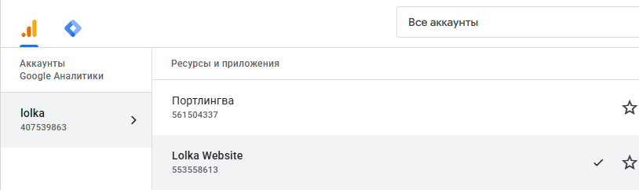
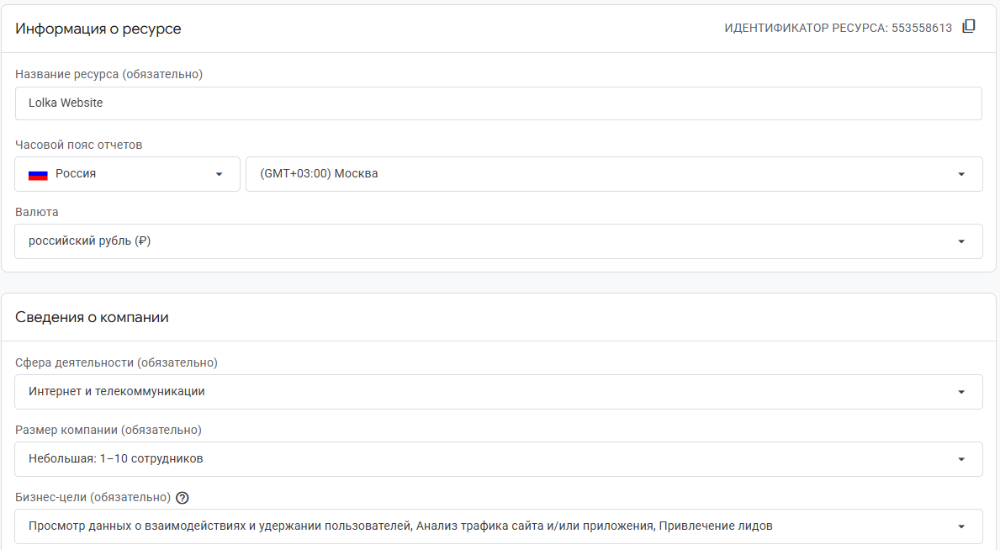
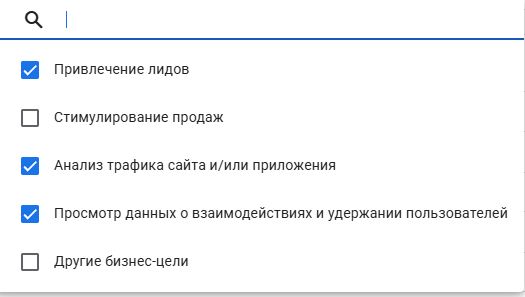
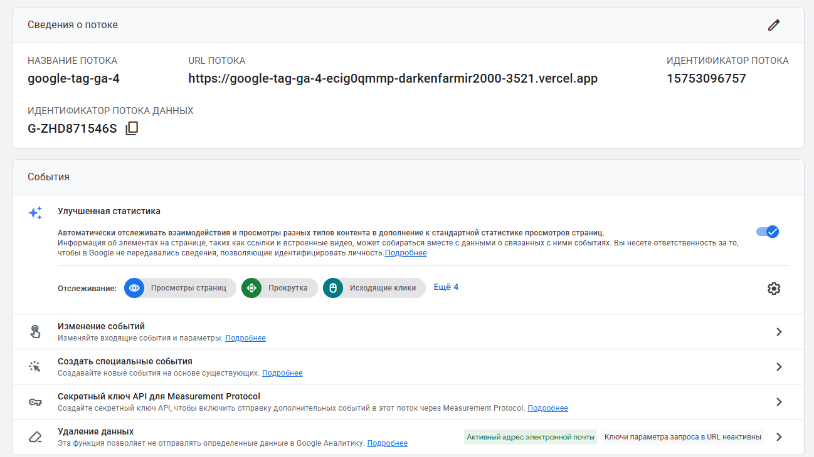
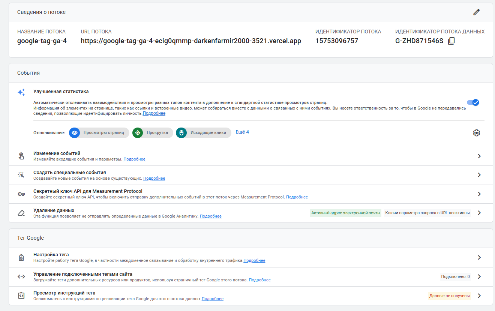

# Домашняя работа № 2 · Где бизнес теряет клиентов

**Дисциплина:** ОП.03 «Информационные технологии»

| Поле | Значение |
|---|---|
| Фамилия, имя, отчество | Михеев Николай Сергеевич |
| Группа | РПО-26/1/11 |
| Номер работы | 2 |
| Тема работы | Анализ воронки цифрового продукта и структура Google Analytics 4 |
| Дата сдачи | 31.10.2026 |

---

# Часть 1. Исследование воронки

## 1.1. Объект исследования

| Поле | Значение |
|---|---|
| Компания, сервис или отрасль | DNS — российская сеть магазинов электроники и бытовой техники |
| Адрес сайта или приложения | https://www.dns-shop.ru/ |
| Целевое действие | Успешное оформление заказа на сайте |
| Почему выбран этот объект | У интернет-магазина DNS понятный путь покупателя: от посещения сайта до покупки. На примере магазина электроники можно разобрать, на каких этапах покупатели могут уходить и какие изменения способны повысить конверсию. |

## 1.2. Воронка

| № | Этап | Что считается переходом дальше | Метрика этапа |
|---|---|---|---|
| 1 | Переход на сайт | Пользователь открывает сайт по рекламе, ссылке или из поисковой системы | Количество посетителей, источники трафика, CTR рекламных объявлений |
| 2 | Поиск товара | Пользователь выбирает категорию или вводит запрос в поиск | Количество переходов в каталог, использование поиска |
| 3 | Просмотр товара | Пользователь открывает карточку смартфона, ноутбука или другой техники | Количество просмотров карточек, доля переходов из каталога |
| 4 | Добавление в корзину | Пользователь нажимает кнопку «Купить» или «В корзину» | Количество добавлений, конверсия из просмотра товара в добавление |
| 5 | Оформление заказа | Пользователь переходит к оформлению, вводит необходимые данные и выбирает способ получения | Количество начатых оформлений, доля завершения оформления |
| 6 | Покупка | Заказ успешно оформлен и зарегистрирован системой | Количество покупок, конверсия в покупку |

**Вывод по воронке**

Потери покупателей могут происходить при поиске товара, изучении характеристик, добавлении товара в корзину и оформлении заказа. Например, пользователь может не найти нужную модель, столкнуться с медленной загрузкой карточки или отказаться от покупки из-за неудобных условий доставки.

Для определения проблемного этапа необходимо собрать реальные данные аналитики и сравнить количество пользователей, переходящих с одного этапа на другой. Фактические показатели внутренней аналитики DNS в данной работе не используются.

## 1.3. Источники

### Источник 1

| Поле | Значение |
|---|---|
| Название материала | «Как оформить заказ» |
| Автор или организация | DNS |
| Дата публикации | На странице не указана |
| Прямая ссылка | https://www.dns-shop.ru/help/useful-information/8145d90b-1c3a-44c4-84b9-bb3f54aa783a/ |

**Выписка из материала:**

На сайте DNS покупатель может выбрать товары, войти в аккаунт или зарегистрироваться, указать способ получения заказа, выбрать способ оплаты и подтвердить заказ. После завершения оформления отображается информация о заказе, включая номер и сведения о получении.

**Что подтверждает и как связано с моей воронкой:**

Материал показывает последовательность действий покупателя DNS при оформлении заказа. Если пользователю сложно войти в аккаунт, выбрать магазин или указать способ получения, он может не завершить покупку. Поэтому важно анализировать переход от начала оформления к подтверждённому заказу.

**Цифры из источника и этап воронки, к которому относятся:**

- На странице описаны основные действия при оформлении заказа.
- Количественные показатели конверсии DNS в материале не приведены.
- Этапы воронки: оформление заказа и покупка.

### Источник 2

| Поле | Значение |
|---|---|
| Название материала | «Доставка товаров» |
| Автор или организация | DNS |
| Дата публикации | На странице не указана |
| Прямая ссылка | https://www.dns-shop.ru/help/delivery/ |

**Выписка из материала:**

На сайте DNS описаны условия доставки товаров, её стоимость и доступные интервалы. Итоговые условия зависят от конкретного заказа и выбранного способа получения.

**Что подтверждает и как связано с моей воронкой:**

Условия доставки могут влиять на решение о покупке. Если пользователь узнаёт итоговую стоимость доставки только на позднем этапе оформления, она может оказаться для него неожиданной. Поэтому для DNS полезно проверить, насколько заметна информация о стоимости и сроках доставки в карточке товара и корзине.

**Цифры из источника и этап воронки, к которому относятся:**

- Стоимость доставки зависит от условий конкретного заказа.
- Фактическая доля отказов из-за стоимости доставки в открытом материале не указана.
- Этапы воронки: просмотр товара, корзина и оформление заказа.

### Источник 3

| Поле | Значение |
|---|---|
| Название материала | «Способы оплаты» |
| Автор или организация | DNS |
| Дата публикации | На странице не указана |
| Прямая ссылка | https://www.dns-shop.ru/help/useful-information/f112d810-a586-4c60-b651-8d328fe0e0e7/ |

**Выписка из материала:**

DNS предлагает покупателям доступные способы оплаты, которые зависят от способа получения заказа и отображаются при оформлении покупки. Варианты могут включать оплату на сайте или в приложении, а также оплату при получении, если такая возможность доступна.

**Что подтверждает и как связано с моей воронкой:**

Если покупатель не находит подходящий способ оплаты или не понимает, как оплатить заказ, он может отказаться от покупки. Поэтому стоит проверить, насколько понятны доступные способы оплаты и на каком этапе пользователь видит эту информацию.

**Цифры из источника и этап воронки, к которому относятся:**

- На странице перечислены варианты оплаты и условия их доступности.
- Данные о количестве пользователей, отказавшихся от покупки из-за оплаты, не опубликованы.
- Этапы воронки: оформление заказа и покупка.

### Источник 4

| Поле | Значение |
|---|---|
| Название материала | «[GA4] Исследование воронки» |
| Автор или организация | Google Analytics Help |
| Дата публикации | На странице не указана |
| Прямая ссылка | https://support.google.com/analytics/answer/9327974?hl=ru |

**Выписка из материала:**

Google Analytics 4 позволяет создавать исследования воронки, чтобы просматривать последовательность действий пользователей и определять, на каких этапах они перестают двигаться к целевому действию.

**Что подтверждает и как связано с моей воронкой:**

Этот инструмент можно применить для анализа пути покупателя DNS: от просмотра товара до добавления в корзину и завершения покупки. Сравнение этапов поможет определить, где наблюдается наибольший отсев пользователей, если сайт передаёт необходимые события в аналитику.

**Цифры из источника и этап воронки:**

- В исследовании можно настроить до 10 шагов воронки.
- Инструмент позволяет анализировать переходы между этапами.
- Это описание возможностей Google Analytics 4, а не статистика DNS.

### Источник 5

| Поле | Значение |
|---|---|
| Название материала | «Как оформить заказ» |
| Автор или организация | DNS |
| Дата публикации | На странице не указана |
| Прямая ссылка | https://www.dns-shop.ru/inet_order_individual/ |

**Выписка из материала:**

На странице оформления заказа DNS пользователь выбирает способ получения, указывает данные доставки при необходимости, выбирает способ оплаты и подтверждает заказ.

**Что подтверждает и как связано с моей воронкой:**

Этот материал позволяет выделить конкретные шаги оформления покупки в DNS. На основе этой последовательности можно построить воронку и проверить, на каких шагах пользователи чаще всего прекращают оформление. Для достоверного вывода понадобятся данные аналитики, а не только просмотр страницы.

**Цифры из источника и этап воронки:**

- На странице описана последовательность оформления заказа.
- Данные о конверсии отдельных шагов не опубликованы.
- Этапы воронки: оформление заказа и покупка.

---

## 1.4. Реальные кейсы и анализ DNS

### Кейс 1. Путь покупателя от выбора товара до заказа

| № | Пункт | Ответ |
|---|---|---|
| 1 | Компания, продукт или рынок | DNS — интернет-магазин электроники и бытовой техники |
| 2 | Как выглядит воронка или её проблемный участок | Пользователь открывает сайт DNS, ищет товар, изучает карточку, добавляет товар в корзину и переходит к оформлению заказа. |
| 3 | В чём может заключаться проблема | Пользователю может быть сложно найти нужную модель, сравнить характеристики или перейти от карточки товара к оформлению заказа. Это возможные проблемы, которые необходимо проверить. |
| 4 | Какие данные или наблюдения нужны для подтверждения проблемы | Количество просмотров карточек, добавлений в корзину, начатых оформлений и завершённых покупок. Также полезно сравнить поведение пользователей на телефонах и компьютерах. |
| 5 | Что можно изменить или протестировать | Проверить удобство каталога и поиска, заметность кнопки добавления в корзину, расположение характеристик и информации о наличии товара. |
| 6 | Как измерить результат | Сравнить конверсию из просмотра карточки в добавление в корзину и из начала оформления в покупку до и после изменений. |
| 7 | Переносим ли подход на объект исследования | Да. Это непосредственно относится к DNS, поскольку целевое действие интернет-магазина — оформление покупки. |

**Источник для анализа:**

https://www.dns-shop.ru/

**Важно:** это анализ пользовательского пути DNS, а не опубликованный компанией эксперимент. Результаты изменений можно утверждать только после измерения показателей.

### Кейс 2. Доставка и оплата при оформлении заказа DNS

| № | Пункт | Ответ |
|---|---|---|
| 1 | Компания, продукт или рынок | DNS — интернет-магазин электроники и бытовой техники |
| 2 | Как выглядит воронка или её проблемный участок | Пользователь выбрал товар, добавил его в корзину, перешёл к оформлению, выбирает доставку или самовывоз и способ оплаты. |
| 3 | В чём может заключаться проблема | Итоговая стоимость доставки, доступность товара или подходящий способ оплаты могут повлиять на решение покупателя. Однако без статистики нельзя утверждать, что именно эти причины вызывают отказы на DNS. |
| 4 | Какие данные или наблюдения нужны для подтверждения проблемы | Количество начатых оформлений, выбор способов получения и оплаты, завершённые покупки, ошибки формы и доля пользователей, не завершивших заказ. |
| 5 | Что можно изменить или протестировать | Проверить, насколько рано покупатель видит стоимость и сроки доставки, наличие товара и доступные способы оплаты. При необходимости протестировать более заметное размещение этой информации. |
| 6 | Как измерить результат | Сравнить долю завершённых заказов и конверсию из начала оформления в покупку до и после изменений. Дополнительно можно сравнить результаты для разных устройств. |
| 7 | Переносим ли подход на объект исследования | Да. На официальном сайте DNS описаны способы получения и оплаты заказа, поэтому эти шаги можно включить в анализ воронки. |

**Источники для анализа:**

- Доставка: https://www.dns-shop.ru/help/delivery/
- Способы оплаты: https://www.dns-shop.ru/help/useful-information/f112d810-a586-4c60-b651-8d328fe0e0e7/
- Оформление заказа: https://www.dns-shop.ru/help/useful-information/8145d90b-1c3a-44c4-84b9-bb3f54aa783a/

**Важно:** это аналитический кейс по процессу оформления заказа DNS. Он не является подтверждённым экспериментом с опубликованными результатами.

---

## 1.5. Причины потери пользователей

| № | Этап воронки | Возможная причина потери | На чём основано предположение | Какие данные DNS нужны для проверки |
|---|---|---|---|---|
| 1 | Этапы 2–3 | Пользователь не находит нужный товар в каталоге или через поиск | Каталог и поиск являются частью пути к карточке товара | Поисковые запросы, переходы в категории, просмотры карточек и выходы с сайта |
| 2 | Этапы 3–4 | Пользователь изучает карточку, но не добавляет товар в корзину | На странице товара покупателю нужно оценить характеристики, цену и наличие | Просмотры карточек, добавления в корзину, тип устройства и скорость загрузки |
| 3 | Этапы 4–5 | Пользователь добавляет товар в корзину, но не начинает оформление | Между выбором товара и оформлением есть отдельный переход | Просмотры корзины, клики по кнопке оформления и доля переходов к следующему этапу |
| 4 | Этапы 5–6 | Пользователь начинает оформление, но не завершает заказ | При оформлении необходимо выбрать способ получения, указать данные и выбрать оплату | Начатые оформления, ошибки форм, выбранные способы получения и количество покупок |

**Вывод**

Для DNS можно выделить четыре направления для проверки: удобство поиска, информативность карточки товара, переход в корзину и простота оформления заказа. Пока нет данных внутренней аналитики, эти причины следует считать гипотезами, а не доказанными проблемами интернет-магазина.

---

## 1.6. Гипотезы улучшения

| № | Этап | Гипотеза | Какие данные нужно собрать | Как проверить, сработало ли |
|---|---|---|---|---|
| 1 | Этапы 2–3 | Если сделать поиск и переходы в популярные категории удобнее, больше посетителей будут открывать подходящие карточки товаров | Поисковые запросы, переходы в категории, просмотры карточек, тип устройства | Сравнить долю переходов в карточки товаров до и после изменений |
| 2 | Этапы 3–4 | Если на карточке товара сделать характеристики, цену, наличие и условия получения более заметными, больше пользователей будут добавлять товар в корзину | Просмотры карточек, добавления в корзину, скорость загрузки и взаимодействия с информацией о товаре | Сравнить конверсию из просмотра карточки в добавление в корзину |
| 3 | Этапы 5–6 | Если заранее и понятно показывать условия доставки, самовывоза и оплаты, больше пользователей будут завершать оформление | Начатые оформления, завершённые заказы, выбранные способы получения и оплаты, ошибки форм | Сравнить конверсию из начала оформления в покупку до и после изменений |

**Общий вывод по части 1**

В этой работе объект исследования — интернет-магазин DNS. Воронка состоит из шести этапов: переход на сайт, поиск товара, просмотр карточки, добавление в корзину, оформление заказа и покупка.

По материалам официального сайта DNS можно изучить процесс оформления заказа, способы получения и оплаты. Однако открытые справочные страницы не содержат фактических показателей конверсии по каждому этапу. Поэтому для определения реальных потерь покупателей необходимо подключить аналитику, настроить события и изучить данные пользователей. После этого можно проверить предложенные гипотезы и определить, какие изменения действительно повышают конверсию.

---

# Часть 2. Google Analytics 4

## 2.1. Пройденные шаги

| № | Шаг | Выполнено |
|---|---|---|
| 1 | Вход в Google Analytics под своим аккаунтом | да |
| 2 | Создан Analytics Account | да |
| 3 | Создан Property | да |
| 4 | Выбраны часовой пояс, валюта и общие сведения | да |
| 5 | Выбраны бизнес-цели | да |
| 6 | Создан ресурс | да |
| 7 | Создан Web Data Stream | да |
| 8 | Проверены Website URL, Stream name, Enhanced Measurement | да |
| 9 | Поток создан | да |
| 10 | Найден Measurement ID | да |

## 2.2. Что получилось

| Поле | Значение |
|---|---|
| Analytics Account | 407539863 |
| Property | 553558613 |
| Reporting time zone | GMT +03:00 |
| Currency | RUB |
| Выбранные бизнес-цели | Все доступные варианты отмечены |
| Stream name | google-tag-ga-4 |
| Website URL | https://google-tag-ga-4-ecig0qmmp-darkenfarmir2000-3521.vercel.app |
| Stream ID (числовой) | 15753096757 |
| Measurement ID (`G-…`) | G-ZHD871546S |
| Enhanced Measurement | Включено |

**Примечание:** указанный ресурс GA4 создан для учебного сайта `google-tag-ga-4.vercel.app`, а не для реального сайта DNS. Его данные нельзя считать статистикой DNS.

Stream ID и Measurement ID — разные идентификаторы. Для подключения веб-сайта используется Measurement ID вида `G-XXXXXXXXXX`.

## 2.3. Скриншоты

Скриншоты необходимо сохранить в папке `screens/` репозитория.

---

## Использование ИИ

| Вопрос | Ответ |
|---|---|
| Что сделано самостоятельно | Выбран объект исследования, подготовлены собственные гипотезы и выполнена настройка учебного ресурса Google Analytics 4 |
| Что спрошено у модели | Помощь в структурировании домашней работы, составлении воронки, формулировании причин потери пользователей и гипотез улучшения |
| Что после этого проверено и изменено | Материалы источников необходимо сверить с оригинальными публикациями. В работе отдельно указано, что данные учебного ресурса GA4 не являются статистикой DNS |

