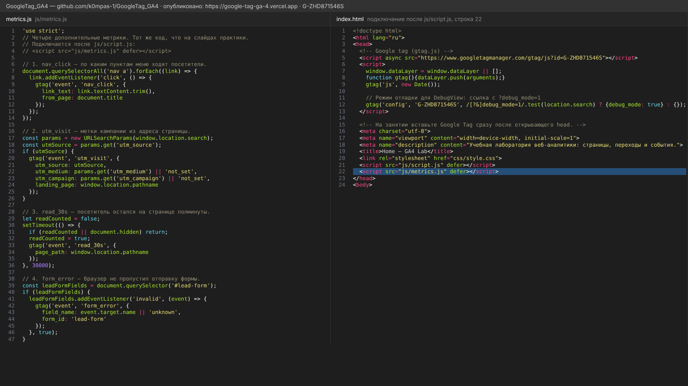
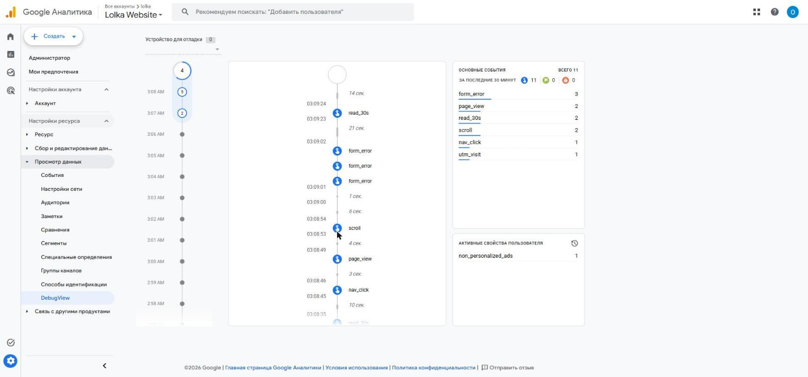
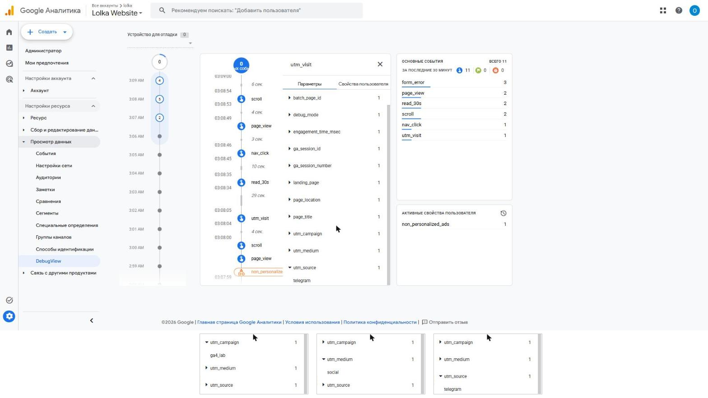
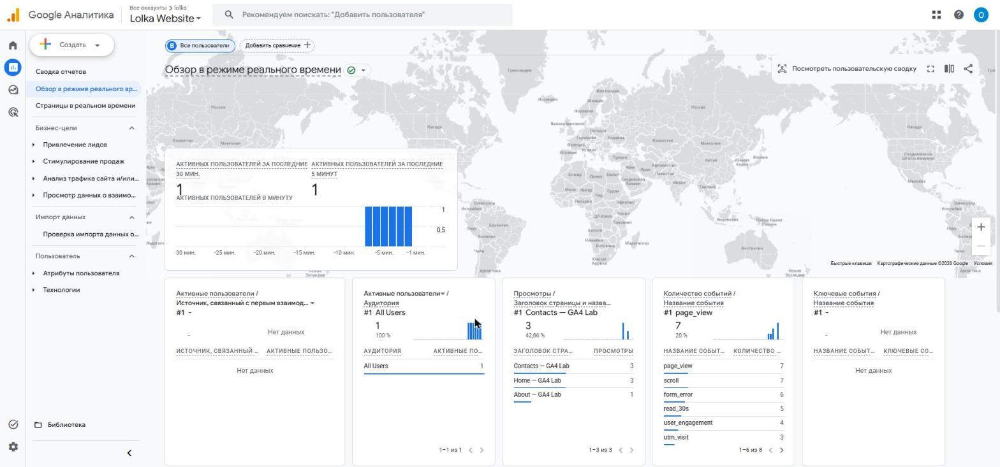

# Домашняя работа № 4 · Свои события и параметры в GA4

**Дисциплина:** ОП.03 «Информационные технологии»

| Поле | Значение |
|---|---|
| Фамилия, имя, отчество | Михеев Николай Сергеевич |
| Группа | РПО-26/1/11 |
| Номер работы | 4 |
| Тема работы | Свои события и параметры: четыре метрики на сайте |
| Дата сдачи | 31.10.2026 |

---

## 1. Мой сайт и мой ресурс

| Поле | Значение |
|---|---|
| Публичный адрес сайта | https://google-tag-ga-4.vercel.app |
| Measurement ID (`G-…`) | G-ZHD871546S |
| Коммит с метриками (ссылка или первые 7 символов) | 5fd9166 |
| Статус публикации | READY |
| Страницы, где подключён `js/metrics.js` | index.html, about.html, contacts.html |

Файл подключается после основного скрипта и на каждой странице по одному
разу: два подключения дают двойные события.

## 2. Какие метрики добавлены

| Событие | Что измеряет | Что делали, чтобы оно сработало |
|---|---|---|
| `nav_click` | клики по пунктам меню | на главной нажал «About» в меню |
| `utm_visit` | метки кампании из адреса | открыл сайт по ссылке с `utm_source`, `utm_medium`, `utm_campaign` |
| `read_30s` | полминуты на странице | пробыл на главной 30 секунд, не сворачивая вкладку |
| `form_error` | форма не прошла проверку браузера | на `contacts.html` нажал «Отправить заявку» с пустыми полями |



## 3. События в DebugView

| Поле | Значение |
|---|---|
| Дата и время проверки | 31.10.2026, 03:08–03:09 |
| Как подключали отладку | `debug_mode`: в `gtag('config')` добавлен `debug_mode: true` для ссылок с `?debug_mode=1` (Tag Assistant не подключился к сайту) |
| Какие из четырёх событий пришли | все четыре: `utm_visit`, `read_30s`, `nav_click`, `form_error` |
| Какие не пришли и почему | — |



## 4. Параметры события `utm_visit`

**Ссылка, по которой открывали сайт:**

```
https://google-tag-ga-4.vercel.app/?utm_source=telegram&utm_medium=social&utm_campaign=ga4_lab&debug_mode=1
```

| Параметр | Значение в ссылке | Значение в GA4 |
|---|---|---|
| `utm_source` | telegram | telegram |
| `utm_medium` | social | social |
| `utm_campaign` | ga4_lab | ga4_lab |
| `landing_page` | — | / |



Если значение в GA4 отличается от значения в ссылке, напишите, в чём разница
и почему так вышло.

> Значения совпадают. Параметр `debug_mode=1` в ссылке нужен только для DebugView, в метки он не попадает.

## 5. Событие вне отладки

| Поле | Значение |
|---|---|
| Где проверяли | Realtime |
| Какое событие искали | `form_error`, `read_30s`, `utm_visit` |
| Сколько срабатываний показал экран | form_error — 6, read_30s — 5, utm_visit — 3 |
| Период (для отчёта) | последние 30 минут |



## 6. Что эти метрики показывают про сайт

> Посетитель пришёл из Telegram по ссылке кампании `ga4_lab`, и метки сохранились в событии `utm_visit`. На главной и на странице контактов задерживались дольше 30 секунд — страницы читают, а не закрывают сразу. Отправка пустой формы даёт сразу три `form_error` (по одному на каждое обязательное поле), значит, видно, какие поля пропускают.

## 7. Что не получилось

> Tag Assistant не смог подключиться к сайту, поэтому отладка включена через параметр `debug_mode` в настройке тега.

## 8. Использование ИИ

| Вопрос | Ответ |
|---|---|
| Что сделано самостоятельно | работа на своём сайте и в своём ресурсе GA4 |
| Что спрошено у модели | помощь с подключением метрик, включением DebugView без Tag Assistant и оформлением бланка |
| Что после этого изменено | добавлен `debug_mode` в `gtag('config')` по параметру ссылки |
