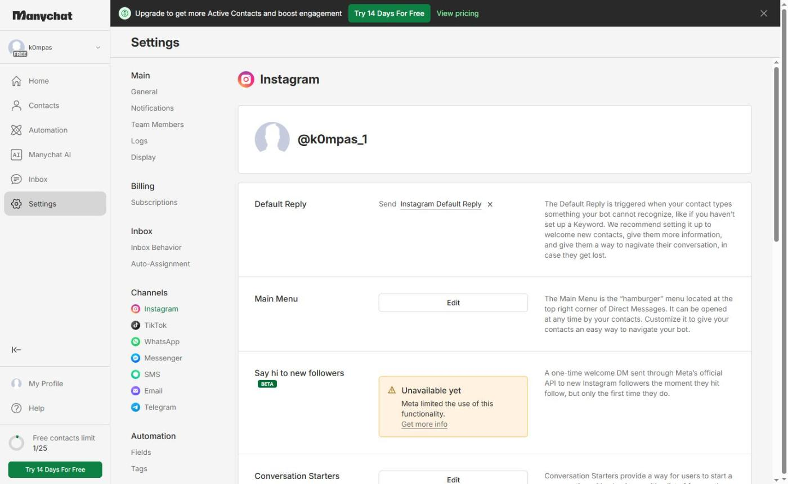
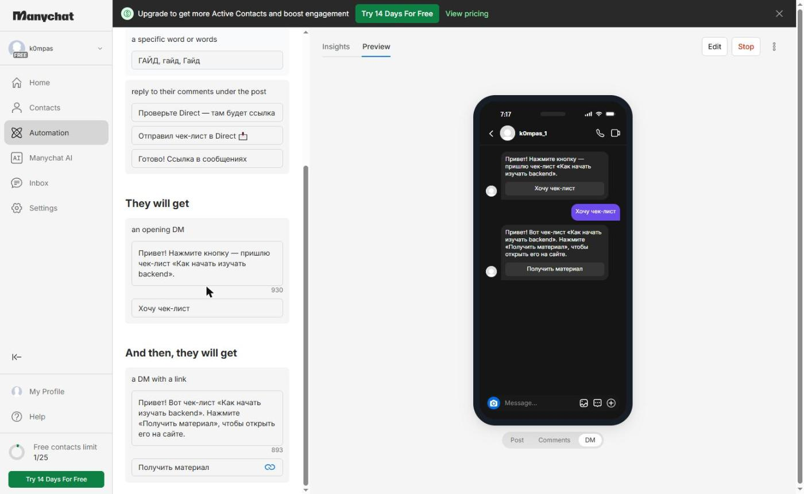
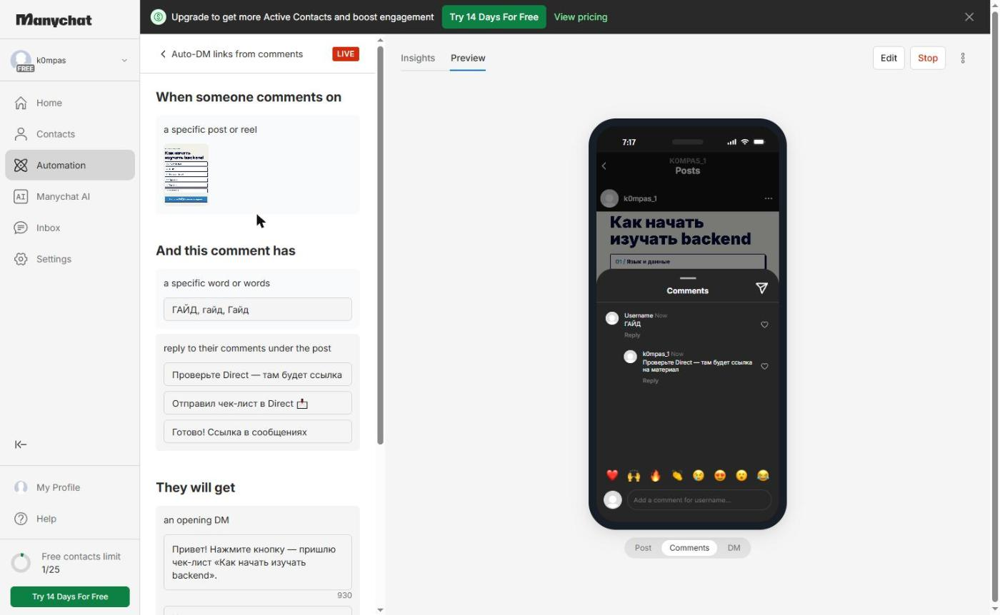
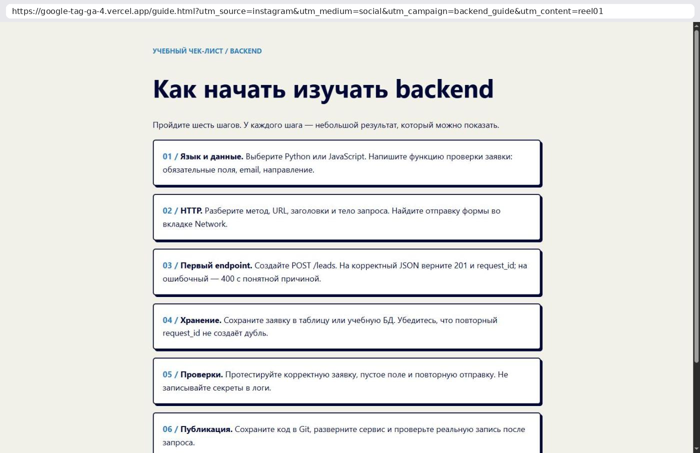
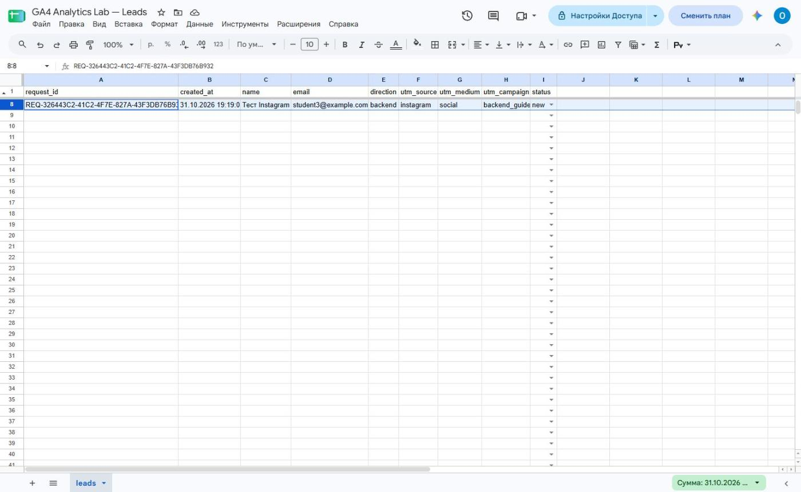

# Домашняя работа № 7 · Instagram → ManyChat → заявка

**Дисциплина:** ОП.03 «Информационные технологии»

| Поле | Значение |
|---|---|
| Фамилия, имя, отчество | Михеев Николай Сергеевич |
| Группа | РПО-26/1/11 |
| Номер работы | 7 |
| Тема работы | Автоворонка из Instagram: комментарий → сообщение → сайт → заявка |
| Дата сдачи | 31.10.2026 |

---

## 1. Подключение и automation

Я перевёл учебный аккаунт Instagram в бизнес-аккаунт и подключил его
к ManyChat на тарифе Free. Собрал automation: триггер на комментарий под
выбранной публикацией, ключевое слово `ГАЙД`, публичный ответ, личное
сообщение и кнопка «Получить материал» со ссылкой с UTM. Automation
включена в режиме Live.

| Мои данные | Значение |
|---|---|
| Учебный аккаунт Instagram | @k0mpas_1 |
| Ссылка на учебную публикацию | https://www.instagram.com/k0mpas_1/p/DfKkDICvnIz/ |
| Публичный адрес сайта | https://google-tag-ga-4.vercel.app |
| Measurement ID (`G-…`) | G-ZHD871546S |

## 2. Тест цепочки

Комментарий со второго аккаунта оставить не удалось: второго учебного аккаунта нет. Цепочку я проверил так: сценарий ManyChat — в предпросмотре (кадры 2 и 3), а переход по ссылке из кнопки — открыв её в браузере. `guide.html` открылась с метками в адресе, оттуда я перешёл к форме и отправил тестовую заявку.

## 3. Результат

В листе `leads` появилась строка с метками `instagram` / `social` /
`backend_guide` и статусом `new`.

`request_id` заявки: REQ-326443C2-41C2-4F7E-827A-43F3DB76B932

---

Не получилось (если всё работает, оставьте пустым): комментарий со второго аккаунта Instagram (кадры 4 и 5) — второго аккаунта нет, automation проверена в предпросмотре ManyChat. Кадр 7: события в GA4 не дошли — на компьютере трекеры Google блокирует VPN, строка заявки при этом записалась.

ИИ: использовал как помощника по настройке и оформлению бланка.
